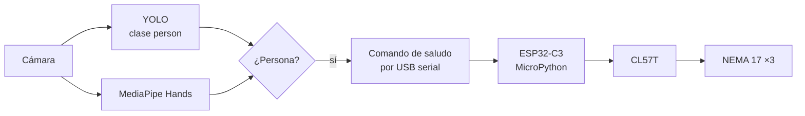

# Manipulador 3-GDL que saluda

> Me pidieron revivir el brazo de 3 grados de libertad del laboratorio para que salude cuando una cámara detecta a una persona.

| | |
|---|---|
| **Tipo** | Becario · Visión · Software |
| **Mi rol** | Detección de persona y mano, y comunicación con el brazo |
| **Estado** | Prototipo |
| **Año** | 2026 |
| **Stack** | Python, YOLO (Ultralytics), MediaPipe Hands, OpenCV, pyserial, ESP32-C3 SuperMini (MicroPython) |

> Proyecto de becario: aquí va la documentación, sin publicar el código.

## El brazo

| Parte | Detalle |
|---|---|
| Articulaciones | Base, codo y muñeca |
| Motores | NEMA 17 con drivers CL57T |
| Controlador | ESP32-C3 SuperMini |
| Firmware | MicroPython (`main_manipulador_final.py`), recibe comandos de texto por USB serial y por I²C |

## Qué hice

- **Detección de humano** con YOLO de Ultralytics (clase `person`) corriendo en la computadora.
- **Detección de mano** con MediaPipe Hands.
- Cuando se detecta a la persona, la computadora manda el **comando de saludo por serial** al ESP32, que ejecuta el movimiento.

## Arquitectura

