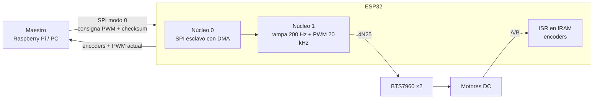

# Controlador de motores ESP32

> Firmware para dos motores DC con encoder: esclavo SPI con DMA, PWM a 20 kHz, rampas a 200 Hz y FreeRTOS en los dos núcleos.

| | |
|---|---|
| **Tipo** | Hardware · Software embebido |
| **Mi rol** | Firmware y etapa de potencia |
| **Estado** | Lógica probada en PC (27 comprobaciones) |
| **Año** | 2026 |
| **Stack** | ESP32, Arduino-ESP32 3.x / ESP-IDF 5.x, FreeRTOS, C++, BTS7960, 4N25 |
| **Repositorio** | [flkochu/controlador-motores-esp32](https://github.com/flkochu/controlador-motores-esp32) |

## Qué hace

Un maestro (Raspberry Pi, PC u otro micro) manda la consigna de PWM de cada motor por SPI y recibe los conteos de los encoders en la misma transacción. El ESP32 se encarga del PWM, de las rampas y de leer los encoders, así que el maestro no tiene que trabajar en tiempo real.

- **Esclavo SPI con DMA** en SPI2: la trama de 16 bytes llega directo a RAM.
- **PWM a 20 kHz y 10 bits** por LEDC, fuera del rango audible.
- **Puentes H BTS7960** con señales aisladas por optoacopladores 4N25.
- **Encoders en cuadratura** por interrupción en IRAM.
- **Rampa trapezoidal a 200 Hz** en el núcleo 1; comunicación en el núcleo 0.
- **Checksum** en cada paquete y **paro si se pierde la comunicación** por más de 200 ms.

## Arquitectura

## Verificación

El `.ino` se compila en la PC contra una simulación de la API del ESP32 y se prueban: configuración del PWM y del SPI, checksum, límites, rampa, sentido de giro, corte de potencia, paro por pérdida de comunicación, encoders y orden de bytes de la telemetría. Las firmas de las funciones del ESP32 se revisaron contra los encabezados oficiales de Arduino-ESP32 3.3.0 y ESP-IDF 5.5. La trama del maestro en Python se prueba con los mismos bytes.

## Cambios al revisarlo

- Se valida el checksum, que antes no se revisaba.
- API de LEDC de Arduino-ESP32 3.x (`ledcAttach`, `ledcWrite` por pin).
- `SPI2_HOST` en lugar de `HSPI_HOST`, que ya no existe en ESP-IDF 5.5.
- Paro por pérdida de comunicación.

## Notas

- GPIO12 es pin de arranque; GPIO34 a 39 no tienen pull-up interno.
- El 4N25 es lento para 20 kHz y deforma el ciclo de trabajo cerca de 0 % y 100 %; un 6N137 lo resuelve.
