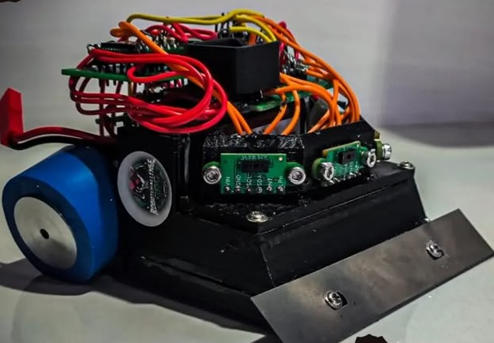
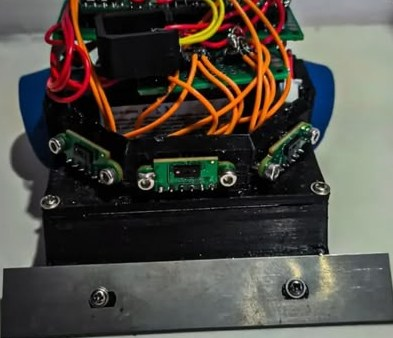
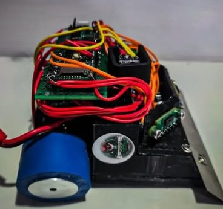

# Mini Sumo Autónomo Pro · RobotChallenge 2026

> Robot de mini sumo autónomo para la categoría Pro de RobotChallenge CGC World Cup México 2026 (13 y 14 de septiembre, CDMX). Busca al oponente con tres sensores LiDAR ToF VL53L5CX que entregan matrices de distancia.

| | |
|---|---|
| **Tipo** | Competencia · Hardware · CAD |
| **Equipo** | 4 estudiantes |
| **Mi rol** | Diseño mecánico y CAD, e implementación de los sensores LiDAR ToF con la Teensy 4.1 |
| **Estado** | Compitió en septiembre de 2026 |
| **Herramientas** | Fusion 360, impresión 3D, colado de silicón, Teensy 4.1, VL53L5CX, I²C |
| **Modelo 3D** | https://flkochu.github.io/sumo/ |

## El robot

- Huella de 10 × 10 cm, el límite del reglamento.
- Base de placa de acero como estructura y lastre.
- Llantas de silicón azul coladas sobre rines impresos con insertos metálicos.
- Cuchilla metálica al frente.
- Tres sensores VL53L5CX en un soporte impreso: uno al frente y dos en diagonal.
- Teensy 4.1 como controlador y driver de motores TB6612FNG.
- Electrónica en tarjetas perforadas apiladas.

Lo dejamos funcionando a menos de tres horas del torneo.

## Decisiones de diseño que tomé

| Decisión | Por qué |
|---|---|
| Base de placa de acero A36/1018 | Hace de estructura y de lastre a la vez: baja el centro de masa y aprovecha el límite de peso |
| Teensy 4.1 como controlador | Velocidad de cómputo para leer los sensores y decidir rápido |
| Sensores ToF VL53L5CX | Cada uno entrega una matriz de distancias en lugar de un solo valor |
| Driver de motores TB6612FNG | El que quedó en el robot armado (el DRV8874 se quedó solo en el diseño original) |
| Llantas de silicón coladas sobre rines impresos con insertos metálicos | Agarre en el dohyo con rines ligeros y resistentes |

## Los sensores: matrices de distancia

Implementé los tres VL53L5CX con la Teensy 4.1. Cada sensor mide la distancia en una cuadrícula de zonas, así que el robot no recibe tres números sino tres matrices, y con ellas decide hacia dónde está el oponente.

Datos del fabricante (ST):

| | |
|---|---|
| Zonas | 4×4 u 8×8 |
| Campo de visión | 45° × 45° (63° en diagonal) |
| Alcance | Hasta 4 m |
| Frecuencia máxima | 60 Hz en 4×4 y 15 Hz en 8×8 |
| Interfaz | I²C de 400 kHz a 1 MHz; dirección 0x52 de fábrica |
| Emisor | Láser VCSEL de 940 nm |

Lo que hay que tener en cuenta al usarlos:

- **Tres sensores con la misma dirección.** Los tres salen de fábrica con la dirección 0x52. En un mismo bus se reasigna la de cada uno manteniendo a los demás apagados con su pin LPn. La Teensy 4.1 también tiene tres buses I²C (Wire, Wire1 y Wire2).
- **Arranque lento.** Al iniciar, el driver le carga al sensor unos 84 KB de firmware por I²C.
- **Imagen invertida.** La lente invierte la imagen en horizontal y en vertical: la zona 0 del arreglo ve la esquina superior derecha de la escena.
- **El piso también aparece.** Con el sensor a pocos centímetros del dohyo, las filas de abajo siempre ven el piso. Para encontrar al oponente hay que distinguir esas lecturas de un objeto real.

## Modelo 3D y simulación

En [flkochu.github.io/sumo](https://flkochu.github.io/sumo/) hay un modelo del robot hecho a partir de las fotos, con las medidas del reglamento, sobre un dohyo de 77 cm. Simula las matrices de los tres sensores con su campo de visión real: arrastras al oponente y se ven las tres matrices cambiar. La lógica de seguimiento del modelo es una demostración y no es el firmware del robot.

## Problemas que resolví

- **Errores de referencias en cascada en Fusion 360**: el ensamble se rompía al editar piezas; lo resolví exportando a STEP y reconstruyendo las referencias.

## Fotos

| | |
|---|---|
|  |  |

## Fuentes

- [Hoja de datos del VL53L5CX (ST, DS13754)](https://cdn.sparkfun.com/assets/6/e/3/0/6/vl53l5cx-datasheet.pdf)
- [UM2884, guía del driver ULD del VL53L5CX (ST)](https://st.com/resource/en/user_manual/um2884-a-guide-to-using-the-vl53l5cx-multizone-timeofflight-ranging-sensor-with-a-wide-field-of-view-ultra-lite-driver-uld-stmicroelectronics.pdf)
- [Biblioteca Wire de Teensy (PJRC)](https://www.pjrc.com/teensy/td_libs_Wire.html)
