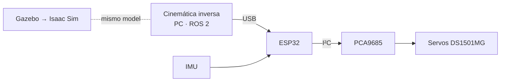

# Perro robot cuadrúpedo

> Retomo el cuadrúpedo de un compañero (solo existía el modelo) y lo llevo a hardware y a ROS 2 Jazzy.

| | |
|---|---|
| **Tipo** | Hardware · Software · ROS 2 |
| **Mi rol** | Electrónica, control y simulación |
| **Estado** | En desarrollo |
| **Año** | 2026 |
| **Base del diseño** | [omerKurkutlu/OK1-QuadrupedRobot](https://github.com/omerKurkutlu/OK1-QuadrupedRobot) |
| **Stack** | ESP32, PCA9685, IMU, ROS 2 Jazzy, Gazebo, Isaac Sim (plan), Python |

## Hardware planeado

| Parte | Componente |
|---|---|
| Actuadores | Servos DS1501MG |
| Controlador | ESP32 |
| Driver de servos | PCA9685 |
| Sensado | IMU |
| Potencia | Regulador DC-DC LB07 de 240 W, 10 A |

## Enfoque de control

1. **Ahora:** cinemática inversa calculada en la PC, que manda los comandos de cada articulación al ESP32 por USB.
2. **En paralelo con el circuito:** el control del perro en ROS 2.
3. **Después:** simulación en Gazebo y luego en Isaac Sim, todo sobre ROS 2 Jazzy con el modelo de OK1.

## Siguiente

- Armar el circuito.
- Control en ROS 2 y simulación.
- Escribir un paper sobre el robot.
