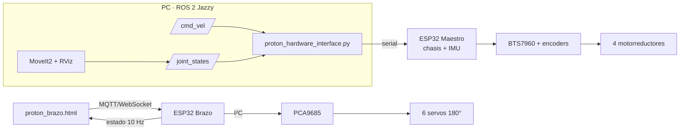

# PROTÓN · Plague Bot VR

> Robot móvil para monitorear invernaderos con visión por IA, un brazo de 6 GDL y teleoperación en realidad mixta. Con mi equipo ganamos el **First Prize de la Huawei ICT Competition 2025–2026**.

| | |
|---|---|
| **Proyecto** | PROTÓN / Plague Bot VR, robot de monitoreo agrícola |
| **Logro** | First Prize, Huawei ICT Competition 2025–2026 |
| **Mi rol** | Electrónica, chasis y control del robot; control del brazo e integración con ROS 2 |
| **Tipo** | Hardware · Software · ROS 2 · Competencia |
| **Año** | 2026 |
| **Stack** | ESP32 (Arduino), BTS7960, PCA9685, MPU6050, MQTT, ROS 2 Jazzy, MoveIt2, RViz, Python, HTML/JS |
| **Simulación 3D** | https://flkochu.github.io/proton/ |
| **URDF del brazo** | [flkochu/proton-brazo-6gdl](https://github.com/flkochu/proton-brazo-6gdl) |

## Contexto

PROTÓN recorre los pasillos del invernadero, detecta plagas y madurez del fruto con YOLOv8 y deja revisar las hojas, incluido el envés, con un brazo de 6 GDL manejado desde realidad mixta. El proyecto es de equipo; **esta página documenta mi parte**.

El robot usa tres ESP32: *Maestro* (chasis), *Esclava* y *Brazo*.

## Qué hice

### Electrónica
- Tres ESP32 con funciones separadas: *Maestro* para el chasis y la comunicación, *Esclava* y *Brazo*.
- Drivers BTS7960 para los motores de tracción con encoders, PWM a 20 kHz.
- IMU MPU6050 integrada al firmware del *Maestro*, publicando `sensor_msgs/Imu`.
- PCA9685 por I²C para los servos del brazo.

### Chasis y control de movimiento
- Chasis de perfil de aluminio con cuatro motorreductores.
- PID de velocidad por rueda con **anti-windup** y **corte de PWM si el encoder no se mueve en 1 s**, después de que un motor se dañó por integral acumulada con la rueda bloqueada.

### Brazo de 6 GDL
- Seis servos de 180° con límites de ±90° alrededor de la posición central, iguales en firmware y en el URDF.
- Control independiente por WiFi y MQTT:

| Tópico | Dirección | Contenido |
|---|---|---|
| `proton/cmd/arm` | entra | JSON con arreglo de ángulos, `home`, `relax` |
| `proton/arm/state` | sale, 10 Hz | ángulos reales del brazo |
| `proton/arm/status` | Last Will | aviso de conexión / desconexión |

- `proton_brazo.html`: interfaz web con **ángulo objetivo contra ángulo real** de cada articulación.

### ROS 2 Jazzy
- `proton_hardware_interface.py`: nodo puente de tópicos de ROS 2 a serial. La cadena `/cmd_vel → nodo → serial → ESP32` funciona.
- MoveIt2 y RViz con un controlador que publica `/joint_states` hacia el hardware real.

### Paper
- Artículo aceptado en COMRob. Ver [Paper de Plague Bot VR](paper-comrob.md).

## Modelo virtual y URDF

Para documentar el robot armé un modelo 3D interactivo y un URDF del brazo a partir del CAD:

- **Pivotes y ejes** ajustados a los cubos circulares de cada pieza: J1 vertical; J2, J3 y J5 de cabeceo; J4 lateral; J6 giro de la cámara.
- **Cinemática verificada**: la simulación web, una cinemática directa independiente y el URDF dan la misma posición de la cámara en 500 configuraciones al azar (diferencia menor a 10⁻⁶ mm).
- **Espacio de trabajo de la cámara** (100 000 configuraciones dentro de ±90°, sin revisar choques): alcance horizontal máximo de 378 mm desde el eje de la base, y altura de −115 a 479 mm respecto a la base.
- El URDF trae mallas de colisión (cascos convexos), que era una de las cosas pendientes.

## Arquitectura

## Siguientes pasos

- [ ] Presentar el paper en COMRob.
- [ ] Probar en MoveIt2 el URDF nuevo, con colisiones.
- [ ] Hacer configurable el puerto serial (hoy está fijo en `/dev/ttyUSB0`).
- [ ] Reintegrar el control por MQTT del brazo con la pila de ROS 2.
