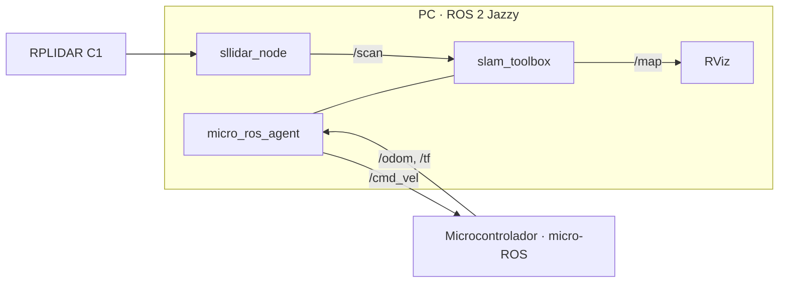

# SLAM 2D con ROS 2 y micro-ROS

> Mapeo con un RPLIDAR C1 y slam_toolbox, con la odometría de una base mecanum calculada en un microcontrolador con micro-ROS.

| | |
|---|---|
| **Tipo** | ROS 2 · Software · Embebidos |
| **Mi rol** | Arquitectura, nodo micro-ROS y configuración de ROS 2 |
| **Estado** | Probado en PC; falta mapear en el robot |
| **Año** | 2026 |
| **Stack** | ROS 2 Jazzy, micro-ROS (`micro_ros_arduino`), slam_toolbox, sllidar_ros2, C++, Python |
| **Repositorio** | [flkochu/ros2-slam-microros](https://github.com/flkochu/ros2-slam-microros) |

## Qué hice

- **Cinemática mecanum** inversa y directa (configuración X) y **odometría** con integración RK2.
- **Nodo micro-ROS** (Teensy 4.1, ESP32 o STM32): recibe `/cmd_vel`, calcula la velocidad de cada rueda, publica `/odom` y la transformada `odom → base_link` en `/tf`, con sellos de tiempo sincronizados con el agente.
- **Launch de ROS 2 Jazzy**: agente micro-ROS, RPLIDAR C1, transformada `base_link → laser_frame` y slam_toolbox en modo asíncrono.

## Arquitectura

## Verificación

- **35 comprobaciones de la cinemática**: la directa invierte a la inversa, los patrones de rueda son los esperados y la odometría coincide con la solución exacta en línea recta, en arco y en desplazamiento lateral (error menor a 1 mm).
- **El nodo compila** contra los encabezados reales de `micro_ros_arduino` (rama jazzy) sin errores ni APIs obsoletas.
- **El launch y los parámetros** se comparan contra los archivos oficiales de slam_toolbox (jazzy) y sllidar_ros2.

## Correcciones al revisarlo

- slam_toolbox en Jazzy es un nodo con ciclo de vida: ahora se incluye su launch oficial, que lo configura y activa.
- Faltaba la transformada `odom → base_link`; ahora la publica el firmware.
- `rclc_timer_init_default` ya no tiene implementación en jazzy: se usa `rclc_timer_init_default2`.
- Baudios del agente igual a los del transporte serial de `micro_ros_arduino` (115200).

## Siguiente

- Odometría con velocidades medidas por encoders (el firmware ya trae el cambio preparado).
- Mapear con el robot y agregar una captura del mapa.

El Sick nanoScan3 se consideró como alternativa al RPLIDAR, pero no se configuró.
